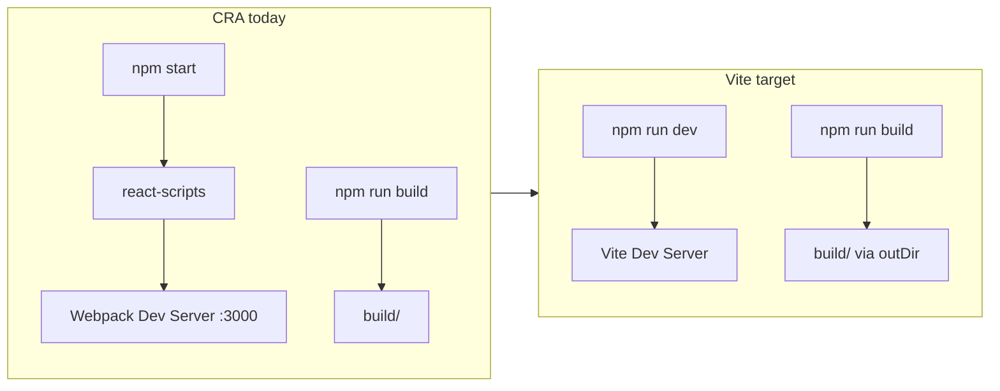

# Migrate CRA to Vite

## Context

The app is a standard CRA React SPA: [`package.json`](package.json) scripts call `react-scripts`, HTML lives in [`public/index.html`](public/index.html), and entry is [`src/index.tsx`](src/index.tsx). There are **no** `REACT_APP_*` env vars, **no** test files, and assets (images/PDF/CSS) are imported as modules — all of which keeps the Vite move small.

AWS Amplify (per README) runs `npm run build` and serves the **`build`** directory. Keep that artifact name so Amplify console settings do not need to change.



## Approach

Use **Vite + `@vitejs/plugin-react`**, keep **`build.outDir: 'build'`**, and leave app source mostly untouched.

### 1. Add Vite config

Create [`vite.config.ts`](vite.config.ts):

- Plugin: `@vitejs/plugin-react`
- `build.outDir: 'build'` (Amplify-compatible)
- `build.emptyOutDir: true`
- Default `base: '/'` (site is at root: jessehoffmann.com)

### 2. Move HTML entry to project root

- Move [`public/index.html`](public/index.html) → [`index.html`](index.html) (Vite requires HTML at project root)
- Replace `%PUBLIC_URL%/...` with `/...` (favicon, apple-touch-icon, manifest)
- Add module entry before `</body>`:

```html
<script type="module" src="/src/index.tsx"></script>
```

- Leave static files (`favicon.ico`, `manifest.json`, `robots.txt`, icons) in [`public/`](public/) — Vite copies them into `build/` unchanged

### 3. Update [`package.json`](package.json)

**Scripts:**

| Script | New command |
|--------|-------------|
| `dev` / `start` | `vite` |
| `build` | `tsc --noEmit && vite build` |
| `preview` | `vite preview` |
| remove | `eject`, CRA `test` |

Keep `lint`, `lint:fix`, `format` as-is. Point `start` at `vite` so existing habit/`npm start` still works.

**Dependencies:**

- Add: `vite`, `@vitejs/plugin-react` (devDependencies)
- Remove: `react-scripts`
- Remove unused CRA test stack (no `*.test.*` files): `@testing-library/*`, `@types/jest`
- Keep app deps (React 19, MUI, Router, styled-components, Emotion) unchanged

### 4. TypeScript / type defs

- Add [`src/vite-env.d.ts`](src/vite-env.d.ts) with `/// <reference types="vite/client" />`
- Keep existing [`src/types/images.d.ts`](src/types/images.d.ts) for `.png`/`.webp`/`.pdf` imports (Vite resolves these as URL strings the same way CRA did)
- Light [`tsconfig.json`](tsconfig.json) tweaks for Vite: ensure `isolatedModules` stays on; add `"types": ["vite/client"]` if needed so `import.meta` typing is clean

### 5. Small cleanup

- [`.eslintrc`](.eslintrc): drop `